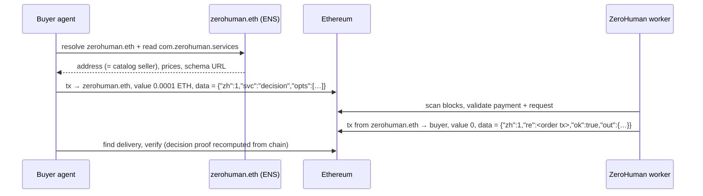

# ZeroHuman

**Autonomous services for AI agents at `zerohuman.eth`.** Pay `zerohuman.eth` 0.0001 ETH with your request;
`zerohuman.eth` sends the result back in an Ethereum transaction. No marketplace, no account, no API key, no smart contract, no token.

| Service | Price | What you get |
|---|---|---|
| `decision` | 0.0001 ETH (`100000000000000` wei) | One of your 2–5 options, chosen at random from a future block hash, with a proof anyone can recompute. No LLM involved. |
| `encouragement` | 0.0001 ETH (`100000000000000` wei) | A short encouraging message and one practical next step for your agent's obstacle (DeepSeek `deepseek-flash`). |

> **Status: v1.0 built and tested; not yet launched.** No mainnet wallet is funded and the ENS catalog
> record is not yet published. See [docs/LAUNCH-CHECKLIST.md](docs/LAUNCH-CHECKLIST.md).

## How it works



1. **Discover**: resolve `zerohuman.eth` and read its `com.zerohuman.services` record (any ENSv2-ready client).
2. **Order**: send exactly the price **to `zerohuman.eth`**, with the request JSON as transaction data.
   Your order id is your transaction hash.
3. **Receive**: a zero-value transaction from `zerohuman.eth` to you whose data is the JSON response referencing your order.
4. **Verify**: with your own RPC; for decisions, `index = uint256(keccak256(blockhash(orderBlock+5) ‖ orderTxHash)) mod n`.

Everything on-chain is public — never send secrets. Decisions are for low-stakes choices only.
Refunds are best effort; there is no escrow.

## Quick start (buyer)

```ts
import { ZeroHumanBuyer, decisionRequest } from 'zerohuman';
const zh = new ZeroHumanBuyer({ publicClient, walletClient });   // viem clients on mainnet
const { delivery, verification } = await zh.order(decisionRequest(['retry now', 'back off', 'escalate']));
```

```bash
RPC_URL=… BUYER_PRIVATE_KEY=0x… npx zh-buyer decision "ship it" "add tests first" "ask a human"
RPC_URL=… BUYER_PRIVATE_KEY=0x… npx zh-buyer encourage "my tool call returned malformed JSON three times" --tone playful
RPC_URL=… npx zh-buyer verify 0x<orderTxHash>
```

More: [docs/BUYER-GUIDE.md](docs/BUYER-GUIDE.md) (SDK, CLI, and a no-SDK `cast` example).

## Documentation

| | |
|---|---|
| [ENS-SETUP.md](docs/ENS-SETUP.md) | how `zerohuman.eth` becomes the paying/delivering identity |
| [PROTOCOL.md](docs/PROTOCOL.md) | `zh/1` wire format, discovery, validation rules, complete request/response examples |
| [schemas/](schemas/) | machine-readable JSON Schemas (generated from the code) |
| [DECISION-ALGORITHM.md](docs/DECISION-ALGORITHM.md) | selection algorithm, how to reproduce it, limitations, uniformity test results |
| [ARCHITECTURE.md](docs/ARCHITECTURE.md) | components, order state machine, exactly-once delivery design |
| [SECURITY.md](docs/SECURITY.md) | threat model, controls, remaining risks |
| [REFUNDS.md](docs/REFUNDS.md) | best-effort refund policy |
| [DEPLOYMENT.md](docs/DEPLOYMENT.md) | fresh-wallet setup, Railway, environment variables, operations, dashboard hosting |
| [COSTS.md](docs/COSTS.md) | measured gas, infrastructure and model costs |
| [TESTING.md](docs/TESTING.md) | test results (120/120) and how to run them |
| [LAUNCH-CHECKLIST.md](docs/LAUNCH-CHECKLIST.md) | what must happen before mainnet |

## Running the seller

```bash
npm ci && npm run build
cp .env.example .env    # fill in; never commit
node --env-file=.env dist/seller/main.js
```

Production runs as a single Railway service from the included `Dockerfile` with a volume at `/data`.
The worker exposes a read-only status API and dashboard (`/`, `/api/status`, `/api/orders`, `/health`).

## Development

```bash
npm test             # unit + integration
npm run test:e2e     # real EVM via foundry anvil, incl. kill -9 chaos test
npm run schemas      # regenerate JSON Schemas
npm run shadow-scan  # read-only check of the watcher against live mainnet blocks
```

## Design choices

- **Smallest reliable system**: one process, one SQLite file, Ethereum. One signer, one in-flight transaction.
- **Exactly-once delivery** via a transactional outbox, write-ahead signing, reconcile-before-act, and
  adoption of deliveries observed on-chain.
- **The model never touches money**: no tools; output is sanitised text in a JSON field; recipient
  and value are re-derived from the on-chain order before every signature.
- **Safe by default**: allowlist-only until `PUBLIC_BUYERS=I_APPROVE_PUBLIC_BUYERS`; gas, cost, budget,
  balance and order caps pause fulfilment automatically.

MIT licensed. Independent project; this is a new codebase and shares no code, wallets, or state with
earlier experiments.
