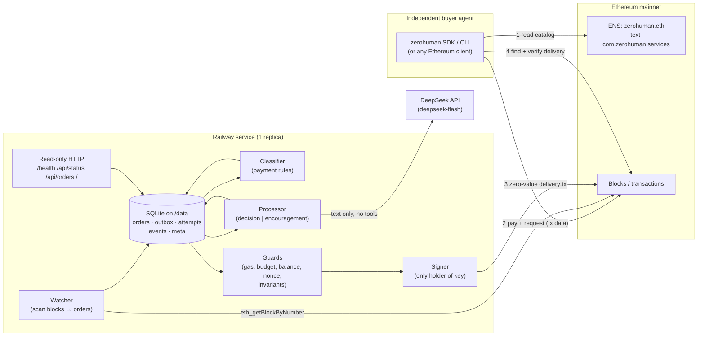
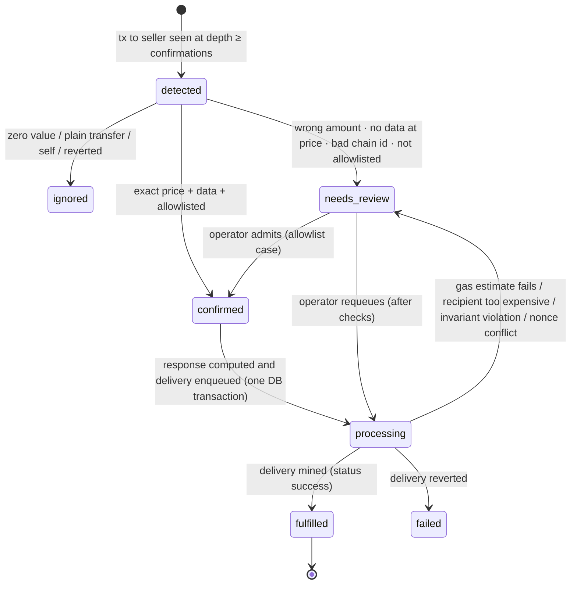

# Architecture

ZeroHuman is one small Node.js/TypeScript process, one SQLite file on a persistent volume, and
Ethereum. No smart contracts, tokens, agent frameworks, queues, or marketplaces.

## Components



The model only ever returns **text** that is validated and placed inside a JSON field. It is never
given tools, the key, RPC access, or any say in a transaction's recipient or value. The guard layer
re-derives recipient and value from the original on-chain order immediately before signing.

## Order state machine



Refunds are a separate column (`none → eligible → approved → queued → sent | declined`).

## Outbox and exactly-once delivery

Every transaction the seller will ever send is first written to `outbox` (delivery / refund /
sweep). `UNIQUE(kind, order_hash)` makes a second delivery for the same order impossible at the
database level.

```mermaid
sequenceDiagram
  participant E as Engine
  participant DB as SQLite
  participant N as Ethereum node
  E->>DB: BEGIN; enqueue delivery; order=processing; COMMIT
  E->>E: guards (gas cap, cost cap, 24h budget, balance, pending-nonce check, invariants)
  E->>E: sign (nonce = latest)
  E->>DB: BEGIN; insert attempt(raw tx, hash, nonce); outbox=signed; COMMIT   ← write-ahead
  E->>N: eth_sendRawTransaction(raw)
  Note over E,N: crash anywhere here is safe
  E->>N: (next tick) receipt for every recorded attempt hash?
  alt mined
    E->>DB: outbox=mined, order=fulfilled, gas cost recorded
  else nonce consumed by an unknown tx
    E->>DB: needs_review + manual "nonce" pause (possible key misuse)
  else still pending & stuck > STUCK_AFTER_MS
    E->>DB: new attempt, same nonce, fees +20% (≤ caps)
    E->>N: broadcast replacement
  else node forgot it
    E->>N: re-broadcast the identical raw tx (same hash)
  end
```

Rules that make this safe:

- **One in-flight transaction at a time.** Nothing new is signed while any outbox item is
  `signed` but unmined, so nonces never race.
- **Write-ahead signing.** The raw signed transaction is durable before it is broadcast. After a
  crash the only possible action is re-broadcasting the *same* bytes or a fee-bumped replacement with
  the *same nonce*; both can mine at most once.
- **Reconcile before act.** Every tick starts by checking receipts for all recorded attempts.
- **Deterministic payloads.** The response is computed once and stored; restarts never call the
  model again for the same order.
- **Durable scan cursor.** Advanced in the same DB transaction as the orders found in that block, so
  a crash cannot skip a block; re-scans are idempotent (`INSERT OR IGNORE` on the tx hash).
- **Single active worker.** A lease row in the DB (TTL 90 s, renewed each tick, released on
  SIGTERM) plus a Railway volume (which pins the service to one instance) prevent two signers.

## Pauses

| Kind | Trigger | Clears |
|---|---|---|
| `operator` | `PAUSED=true`, `zh-admin pause`, invariant violation, RPC chain-id mismatch | `zh-admin resume operator` |
| `nonce` | unknown pending tx from the seller, or nonce consumed by an unknown tx | `zh-admin resume nonce` (after investigation) |
| `gas` | base fee + tip > `MAX_FEE_PER_GAS_GWEI`, or worst-case delivery cost > `MAX_DELIVERY_COST_WEI` | automatically |
| `budget` | rolling 24 h gas spend would exceed `DAILY_GAS_BUDGET_WEI` | automatically |
| `balance` | wallet can't cover value + worst-case gas | automatically |
| `order_cap` | > `MAX_ORDERS_PER_DAY` fulfilments in 24 h | automatically |
| `rpc` | last tick had an RPC error (informational) | automatically |

## Repository map

```
src/protocol/     zh/1 constants, zod schemas, codec, decision algorithm, catalog   (shared, no I/O)
src/services/     encouragement prompt + sanitiser; llm/ provider abstraction (DeepSeek, mock)
src/seller/       config, store (SQLite), chain adapter (viem), engine, http, main
src/sdk/          public buyer SDK (ENS catalog, submit, wait, verify)
src/cli/          zh-buyer, zh-admin, catalog print/check, keygen
schemas/          generated JSON Schemas (npm run schemas)
dashboard/        static read-only status page
scripts/          schema generator, mainnet shadow scan, Sepolia end-to-end
test/             unit, integration (mock chain), e2e (anvil + chaos)
```
